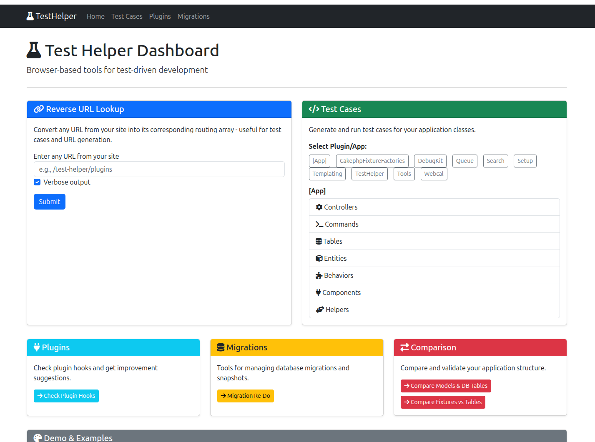

# Getting started

TestHelper adds a browseable developer backend at `/test-helper` for your CakePHP app,
collecting several day-to-day tools in one place.



::: tip
These tools run application tests and can generate files. Keep them behind your development access gate. See
[Configuration](/configuration) for the authorization and back-link options.
:::

## Tools

| Tool | What it does |
|------|--------------|
| [Association vs DB Audit](/associations) | Compare declared associations against the real database foreign keys, with copy-paste fixes |
| [SQL to Query Builder](/sql-converter) | Convert raw SQL into CakePHP Query Builder code |
| [Test Runner](/test-runner) | Run tests and view results/coverage in the backend; bake missing test files |
| [Fixture Check](/fixture-check) | Compare fixtures against the live DB schema |
| [URL Tools](/url-tools) | Generate URL arrays from string URLs (reverse lookup) |
| [Plugin Info](/plugins) | Inspect plugins, their hooks, and suggested improvements |
| [Custom Linter Tasks](/linter) | Project-specific code-quality checks via `bin/cake linter` |

## Try the backend

Complete [Installation](/installation) first, then open `/test-helper` in your local application. The dashboard lists available class types and links to the tools.

Start with the **Reverse URL Lookup** form on the dashboard: enter the path of an existing application route, such as `/test-helper`, and submit it. The result shows the route parameters that CakePHP matched. This checks routing without running tests or modifying database tables.

For a first CLI check, run:

```bash
bin/cake linter --help
```

Review [Custom Linter Tasks](/linter) before selecting tasks. Some tasks can update files; inspect their options and use a disposable checkout for the first run.

## Access and optional tools

The backend uses its own controller base, so it does not inherit your application's AppController authentication callbacks. Application middleware still applies. Debug-only loading limits where the routes exist; it does not authenticate visitors to a publicly reachable development server.

Keep the backend on a private development instance or behind your application middleware access gate. With the Authorization plugin, TestHelper automatically skips authorization checks while debug is enabled; `TestHelper.ignoreAuthorization` also skips them. See [Configuration](/configuration) for these settings.

The dashboard and URL tools do not require Bake or a coverage extension. Generating tests needs Bake; browser test execution needs PHPUnit and permission to launch PHP processes. Database tools need the relevant database connection. See [Installation](/installation#optional-tools) for the optional packages.

See [Troubleshooting](/troubleshooting) if the backend does not render.
