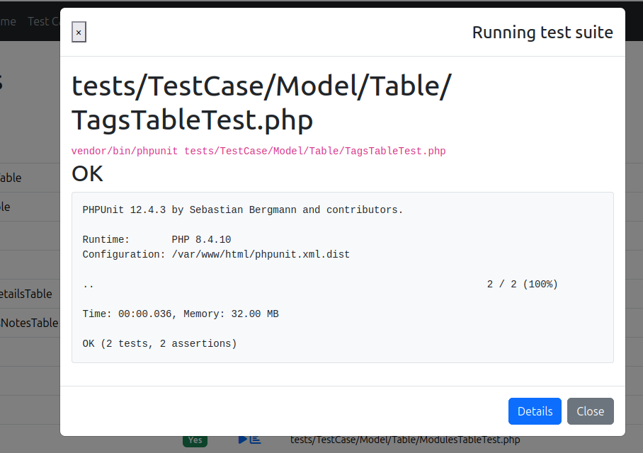

# Test Runner

Run your test suites from the backend and view the results, or coverage, without leaving
the browser.

Select the app or a plugin, choose the type of classes you want to test, then click the
**run** icon.

::: tip
If a class has no test file yet, an **add** icon appears next to it, click it to bake the
test for you.
:::



## Configuration

```php
'TestHelper' => [
    // Custom phpunit command. Both `php phpunit.phar` and `vendor/bin/phpunit` work out of the box.
    'command' => null,
],
```

See [Configuration](/configuration) for the full list of options.

::: warning
If the coverage report renders in black & white, your web server may be blocking hidden
files (the assets). See [Troubleshooting](/troubleshooting#coverage-report-is-black-white).
:::

## CLI execution and coverage

The web PHP process launches PHPUnit from the application root. The configured `TestHelper.php` executable is used by the default PHPUnit command; a custom `TestHelper.command` controls its own executable and arguments. Test file and method-filter values are passed as quoted arguments.

Results include stdout and stderr. Tests run as the web-server user, so that account needs the same application configuration, database access, and file permissions as a CLI test run.

Coverage uses PHPUnit's `--coverage-filter` option and writes reports under `webroot/coverage`. Install and enable Xdebug or PCOV in CLI PHP; selecting a driver in configuration does not install it. TestHelper sets Xdebug's coverage environment mode for the launched process. The legacy `coverage` setting no longer selects a driver. An unsuccessful coverage command displays its captured diagnostics when no report was created.

The output directory is publicly served by many application web servers. Keep the developer backend and generated reports on a private development instance; remove reports when they are no longer needed.

Long-running suites can exceed PHP, web-server, or proxy request timeouts. Run those suites directly from the CLI. The browser runner is suited to individual files and shorter checks.
